  
  
  
  

I work where research meets production. By day I build LLM document pipelines, data-quality systems and predictive models for a US seed company. Before that I spent my thesis teaching a robot to navigate with two LLMs arguing in its head.

I like problems where the model is only half the job and the other half is making it reliable for the people who use it.

## Research

| Year | Paper | Where | My part |
| :--- | :--- | :--- | :--- |
| 2025 | [A novel voice in head actor critic reinforcement learning with human feedback framework for enhanced robot navigation](https://www.nature.com/articles/s41598-025-92252-w) | *Scientific Reports* (Nature Portfolio) 15, 7237 | First author, bachelor's thesis |
| 2024 | [An Improved NDVI Estimation Using Grounded DINO and Segment Anything Model for Plant Health Classification](https://ieeexplore.ieee.org/abstract/document/10535513/) | *IEEE Access* 12, 75907–75919 | Second author, [code](https://github.com/codex-exe/LNDVI) |
| 2024 | [AgTech](https://doi.org/10.1201/9781003465775-4), a chapter on sensors and machine learning for farming | CRC Press, *Machine Learning Hybridization and Optimization for Intelligent Applications*, pp. 45–63 | Co-author |

## Things I've built

<table>
  <tr>
    <td width="50%" valign="top">
      
      <h3><a href="https://www.nature.com/articles/s41598-025-92252-w">Voice in Head RL</a></h3>
      GPT-4 and Gemini act as actor and critic inside a PPO loop, so a robot can reason about where to go in places it only partly sees. Built in Unreal Engine and AirSim. Up to 94.54% navigation success, ahead of DQN and PPO baselines.
        
      <code>reinforcement-learning</code> <code>LLM</code> <code>RLHF</code> <code>AirSim</code>
    </td>
    <td width="50%" valign="top">
      
      <h3><a href="https://github.com/codex-exe/LNDVI">LNDVI</a></h3>
      Plant-by-plant health scoring from plain RGB images. Grounding DINO finds each plant with zero-shot detection, Segment Anything cuts it out, and a localized index scores it. No multispectral camera needed. Published in IEEE Access.
        
      <code>grounding-dino</code> <code>segment-anything</code> <code>PyTorch</code>
    </td>
  </tr>
  <tr>
    <td width="50%" valign="top">
      
      <h3><a href="https://github.com/codex-exe/Krishi-Junction">Krishi Junction</a></h3>
      AgTech prototype that combines crop prediction, fertilizer optimization, drone simulation and Raspberry Pi sensor monitoring. 1st runner-up at the Solving for India Hackathon nationals (Google Cloud, AMD, GeeksforGeeks), 2023.
        
      <code>IoT</code> <code>Django</code> <code>google-cloud</code> <code>raspberry-pi</code>
    </td>
    <td width="50%" valign="top">
      
      <h3><a href="https://github.com/codex-exe/yolov7-mediapipe">Smart Home Interactions</a></h3>
      Point at a device and say what you want. YOLOv7 finds the devices, MediaPipe tracks your arm, offline speech recognition hears the command and a NodeMCU flips the switch.
        
      <code>yolov7</code> <code>mediapipe</code> <code>vosk</code> <code>HRI</code>
    </td>
  </tr>
  <tr>
    <td width="50%" valign="top">
      
      <h3><a href="https://github.com/codex-exe/PPO-sleep-signature">PPO Sleep Signature</a></h3>
      A PPO agent trained on real wearable and sleep data from 22 people (the MMASH dataset) to learn which daily activities help or hurt each person's sleep.
        
      <code>reinforcement-learning</code> <code>PPO</code> <code>TensorFlow</code>
    </td>
    <td width="50%" valign="top">
      
      <h3><a href="https://github.com/codex-exe/walter">Walter</a></h3>
      A voice-controlled robot car. Speak into your phone, the command goes over Bluetooth to an Arduino, and an ultrasonic sensor keeps it from driving into walls.
        
      <code>arduino</code> <code>C++</code> <code>bluetooth</code>
    </td>
  </tr>
</table>

Also here: [FFtemplate](https://github.com/codex-exe/FFtemplate), a function-calling copilot that turns a chat with a technician into a structured, searchable fix document.

## What I do now

**Product Analyst, AI & Data Governance at Rice Tec** (May 2024 – present)

- Built LLM document intelligence workflows that turned a 3+ month manual job into a 3-day run: 1,500+ documents at about 90% lower processing cost.
- Lead data governance with quality frameworks and monitoring, plus an ML-based fuzzy matching system that connects tables which did not join.
- Develop predictive models for crop purity and yield, and the ETL pipelines and dashboards that feed them.

**AI Consultant on Upwork** (Jan 2024 – present). Top Rated, 100% Job Success. LLM solutions, RAG, data pipelines and Power BI reporting for clients.

## Toolbox

| | |
| :--- | :--- |
| **AI & ML** | PyTorch · TensorFlow · scikit-learn · LLMs (GPT-4, Gemini) · RAG · PPO · OpenCV · Grounding DINO · Segment Anything · YOLOv7 · MediaPipe |
| **Robotics & edge** | ROS · AirSim · Unreal Engine · LiDAR + depth fusion · Raspberry Pi · Arduino · NodeMCU · Verilog |
| **Data & cloud** | Python · SQL · PySpark · Azure AI Foundry · Azure AI Search · Azure OpenAI · Microsoft Fabric · Power BI · Google Cloud |

## Say hello

The fastest way to reach me is the contact form on [my portfolio](https://alabhyasharma-portfolio.web.app/#contact), or a message on [LinkedIn](https://www.linkedin.com/in/alabhya-sharma-8254301b8/).
